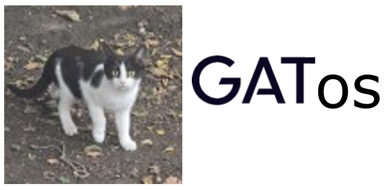
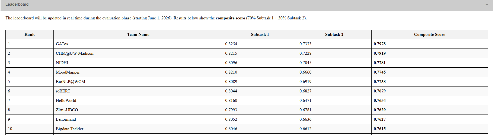

# GATos: Explainable Suicide Risk Detection

These are the three Google Colab notebooks from our submission to the [IEEE BigData Cup 2026 Explainable Suicide Risk Detection challenge](https://www.bigdatacompetition.cn/). The method is described in our paper, *Task-Specific Ensembles and Human-Guided Refinement for Explainable Suicide-Risk Detection*.

Vitosh K. Doynov, Ensiye Kiyamousavi, and Boris Kraychev  
[GATE Institute](https://www.gate-ai.eu/en/) - Big Data for Smart Society, Sofia, Bulgaria

## Why GATos?

We're from GATE, and we like cats. GATos seemed like a good fit: *gátos* (γάτος) means a cat in Greek and in Spanish. 
😸🐱😻

## The task

Given a Reddit post from [r/SuicideWatch](https://www.reddit.com/r/SuicideWatch), the system predicts a risk level (`Indicator`, `Ideation`, `Behavior`, or `Attempt`), extracts phrases supporting that prediction, and identifies the risk and protective factors mentioned in the text. There are 24 possible factor labels, including mental health issues, hopelessness, social support, and coping strategies. Evidence phrases are copied from the input post.

## Our approach

### Model-Ensemble

We trained separate models for risk, evidence, and factors. Training and validation used five folds grouped by user, so posts from the same author stayed in the same fold.

For risk classification, we combined DeBERTa-v3 and RoBERTa classifiers with a Qwen2.5-7B model fine-tuned using QLoRA. We also asked a frozen Qwen2.5-72B model 15 fixed yes/no questions about the post: whether it describes current intent, preparation, a past attempt, or someone else's experience, for example. The resulting scores and the classifiers' predictions were used as features for the risk meta-classifier.

For evidence extraction, encoder models proposed candidate spans. A learned regressor scored sets of phrases to reflect the evaluation's one-to-one phrase matching. For factors, we combined a multi-label classifier with models that compare each post against factor definitions, then calibrated a threshold for each factor.

### GATos-Improver

We reviewed the model predictions and recorded approved corrections as versioned decisions. The Improver supports two modes:

- `unseen-auto` applies a small set of automatic rules to new predictions and records what changed. The rules leave a prediction alone when their conditions are not met or the evidence is ambiguous.
- `public-replay` reproduces the historical reviewed submission using the matching original inputs, raw predictions, and saved decisions.

The FinalEvaluation notebook runs Model-Ensemble followed by `unseen-auto`. It does not require interactive review.

## Notebooks

| File | What it contains |
| --- | --- |
| [GATos_ModelEnsemble_Colab.ipynb](GATos_ModelEnsemble_Colab.ipynb) | Model prediction and optional full training through `fresh-training` mode |
| [GATos_Improver_Colab.ipynb](GATos_Improver_Colab.ipynb) | Automatic refinement and historical public-result replay |
| [GATos_FinalEvaluation_Colab.ipynb](GATos_FinalEvaluation_Colab.ipynb) | Saved-model prediction and automatic refinement on a new workbook |

The notebooks preserve the commands and paths used in our submission. Running them requires the accompanying GATos Python packages, configuration, trained artifacts, and authorized data access. These are not included in this repository; the notebooks and requirements files alone do not provide a runnable installation. The saved-model workflow still reads the original training workbook to fit small downstream risk and evidence estimators.

### Execution environment

The GPU workflow was tested with Python 3.12.13 and an NVIDIA A100 80 GB in Google Colab. It runs in three fresh sessions:

1. **A:** QLoRA inference, or encoder and QLoRA training in `fresh-training` mode.
2. **B:** scoring with the frozen 72B model.
3. **C:** encoder predictions, calibration, and final output. FinalEvaluation also applies the automatic Improver rules here.

Sessions A and C use [requirements-train.txt](requirements-train.txt); B uses [requirements-probes.txt](requirements-probes.txt). They need separate sessions because the dependency versions differ. The standalone Improver runs on a CPU with [requirements-improver.txt](requirements-improver.txt).

## Results

GATos finished first on the public leaderboard and fourth in the organizers' final competition ranking. These were separate evaluations. Our public scores were:

| Submission | Subtask 1: risk + evidence | Subtask 2: factors | Composite |
| --- | ---: | ---: | ---: |
| Model-Ensemble | 0.7941 | 0.6410 | 0.7482 |
| Final reviewed submission | 0.8254 | 0.7333 | 0.7978 |

The composite is `0.7 × Subtask 1 + 0.3 × Subtask 2`, equivalent to 40% risk weighted F1, 30% evidence phrase F1, and 30% factor macro F1.

The 0.7978 result includes human review informed by public leaderboard feedback. It does not measure automatic performance on unseen posts. Separate held-out component scores were not available to us.

Public leaderboard snapshot from the [competition website](https://www.bigdatacompetition.cn/), accessed on 23 October 2026.

## Data

The dataset was compiled by The Hong Kong Polytechnic University from Reddit posts. We have not included the competition workbooks, source posts, trained artifacts, prediction files, or case-level review records in this repository.

Researchers should obtain dataset access directly from the organizers under the [Data Usage Agreement](https://www.bigdatacompetition.cn/). The agreement permits non-commercial educational and research use by authorized recipients and requires prior written consent to transfer any part of the dataset to others. The name `public-replay` refers to the public leaderboard, not to permission to redistribute its data.

This work has not been validated for clinical use.

## Acknowledgement

We thank the organizers of the Explainable Suicide Risk Detection challenge and acknowledge The Hong Kong Polytechnic University for providing the dataset used in our experiments ([Li et al., 2025](https://arxiv.org/abs/2507.10008)).
